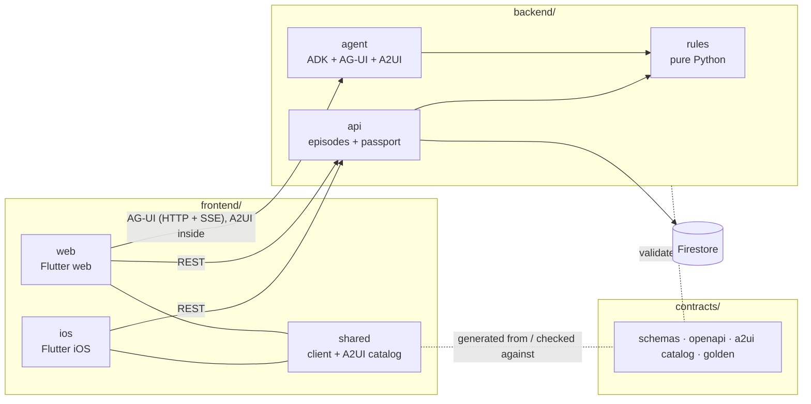

# rabo4good-AImesis

AI-assisted control of chemotherapy-induced nausea and vomiting (CINV) in children.
Built by the Rabobank team at **Solve with Google: Hacking for Good 2026** (Wintercircus Ghent, 29 Oct 2026), use case 3 for the Belgian Society of Paediatric Haematology and Oncology (BSPHO), with clinical leads from UZA (University Hospital Antwerp).

> **Prototype. Not for clinical use.** No real patient data goes into this repo, the apps, logs or prompts.

---

## What we are building

| Who uses it | Part | What it does |
|---|---|---|
| Oncologist, nurse specialist, clinical pharmacist | **Web frontend** (Flutter web) | Classifies the chemo regimen, calculates antiemetic doses, applies the dexamethasone rules, screens interactions, compares UZA v2 with POGO, produces the CINV Patient Passport. |
| Parents and the child at home | **iOS frontend** (Flutter iOS) | One tap per episode of nausea or vomiting, the family's Passport schedule in NL, FR or EN, and the log feeds the next cycle. |

It covers the six UZA user stories plus the companion-app bonus:

1. Emetogenicity classification (UZA v2 tiers, dose thresholds, combination rules, per-day tiers)
2. Antiemetic doses from BSA, weight and age, with formula and source shown
3. Personalisation: dexamethasone block, route and formulation, previous-cycle history, breakthrough steps
4. CINV Patient Passport (one page, NL/FR/EN, dual sign-off)
5. UZA v2 vs POGO comparison
6. Drug interaction and contraindication screening
- Bonus: companion app for logging episodes

The full acceptance criteria, expected outputs for Casus 1–3, edge cases and the open questions for the pharmacists are in the team doc **"AImesis — Build-ready User Stories (UZA v2)"** (shared via claude.ai), together with a clickable reference prototype of all pages.

---

## Ground rules (the jury checks these)

1. **The model never calculates.** Risk tiers, doses, durations, dexamethasone blocks and interaction alerts come from `backend/rules`, plain Python with no LLM. The agent only extracts structure from free text, picks which rule to call, and writes the summary and family wording.
2. **Every clinical line cites its rule.** For example "UZA v2 p.2 · Ondansetron 5 mg/m², max 8 mg/dose".
3. **Refuse rather than guess.** If BSA, weight or age is missing, or a drug is not in UZA v2, show what is missing and calculate nothing.
4. **Advisory only, two sign-offs.** Every screen shows "Advisory only — requires clinician sign-off". Export needs the oncologist and the pharmacist.
5. **Belgian grounding.** Formulations and interactions cite BCFI/CBIP. Family links come from the Belgian resources sheet.
6. **Source of truth:** UZA "Anti-emetica beleid CINV" juli 2026 versie 2. POGO (released 2010) is only used for the Story 5 comparison.
7. **Clinical source documents stay out of git.** Keep the UZA policy, POGO PDF, case examples and decks in `docs/source/` locally; that folder must be git-ignored.

---

## How the repo is split

Four areas with hard boundaries. **Frontend and backend never import each other's code**: they only share what is in `contracts/`.

| Area | What lives there | Deploys as | Talks to |
|---|---|---|---|
| `frontend/web` | Flutter web app for the care team | Cloud Run service `web` (static build) | `backend/agent` over AG-UI, `backend/api` over REST |
| `frontend/ios` | Flutter iOS app for families | iPhone (Xcode) or Flutter web fallback | `backend/api` over REST only |
| `frontend/shared` | Dart packages both apps use: API/AG-UI client + models, A2UI component catalog | — (library) | — |
| `backend/rules` | Pure Python rules engine: UZA v2 tiers, doses, dexamethasone, breakthrough, interactions, POGO comparison. No LLM, no web framework. | — (library) | nothing |
| `backend/agent` | ADK agent (Gemini), AG-UI endpoint, A2UI surface builder, ward-note extraction | Cloud Run service `agent` | `backend/rules` (import) |
| `backend/api` | REST: episodes (Firestore), Passport PDF | Cloud Run service `api` | `backend/rules` (import), Firestore |
| `contracts/` | JSON Schemas, OpenAPI, AG-UI events we use, A2UI catalog, golden test cases | — | read by both sides |
| `infra/` | Terraform for everything above | — | — |



### How a request flows

1. The clinician opens a patient in `frontend/web`, which starts an **AG-UI** run against `backend/agent`.
2. The **ADK agent** extracts the regimen and history, then calls `backend/rules`. It never writes a dose itself.
3. The agent turns the rules' output into **A2UI** surface messages (declarative JSON: which component, which data). They stream back inside the AG-UI event stream.
4. The web app renders them with **our A2UI catalog** (`frontend/shared/aimesis_a2ui_catalog`): only components we approved. The agent can't send arbitrary UI or code.
5. User actions (sign-off, ticking a clinician option, confirming a quoted note) go back to the agent as AG-UI events.
6. `frontend/ios` only uses REST: it posts episodes to `backend/api` and fetches the family Passport. No agent involved.

### The three protocols and libraries

| Piece | Role here | Links |
|---|---|---|
| **AG-UI** | Event protocol between `frontend/web` and `backend/agent`: streaming text, tool-call events, state updates, user actions. | [docs.ag-ui.com](https://docs.ag-ui.com/introduction) · Dart client [`ag_ui`](https://pub.dev/packages/ag_ui) · ADK server [`ag_ui_adk`](https://pypi.org/project/ag_ui_adk/) |
| **A2UI** | What the agent sends to draw UI: declarative JSON surfaces, rendered from a client-side catalog. | [a2ui.org](https://a2ui.org/) · [quickstart](https://a2ui.org/quickstart/) · [github.com/a2ui-project/a2ui](https://github.com/a2ui-project/a2ui) |
| **GenUI for Flutter** | Flutter renderer for A2UI surfaces. | [docs.flutter.dev/ai/genui](https://docs.flutter.dev/ai/genui/get-started.md) · [`genui`](https://pub.dev/packages/genui) · [`genui_a2ui`](https://pub.dev/packages/genui_a2ui) (marked discontinued in favour of [`genui_a2a`](https://pub.dev/packages/genui_a2a/versions/0.10.0)) |
| **ADK** | Agent framework, already used by the starter kit. | [adk.dev](https://adk.dev/) |

---

## Stack

| Area | Choice |
|---|---|
| `frontend/` | Flutter (stable), Dart ≥ 3.6 with a [pub workspace](https://dart.dev/tools/pub/workspaces) rooted at `frontend/pubspec.yaml` |
| `backend/` | Python 3.12, [`uv` workspace](https://docs.astral.sh/uv/concepts/projects/workspaces/) rooted at `backend/pyproject.toml`; ADK, FastAPI, `ag_ui_adk`, Gemini |
| Data | Firestore (native mode) |
| `infra/` | Terraform; Cloud Run services `web`, `agent`, `api`; Artifact Registry; region `europe-west1` |
| CI | One GitHub Actions workflow per area, triggered only by changes in that area |

---

## Repository layout

Every file below exists and is **empty**. Fill them in as you build.

```
.
├── README.md
├── .gitignore  .editorconfig
├── .github/
│   ├── pull_request_template.md
│   └── workflows/
│       ├── frontend-web.yml        runs on frontend/web/** + frontend/shared/**
│       ├── frontend-ios.yml        runs on frontend/ios/** + frontend/shared/**
│       ├── backend.yml             runs on backend/** + contracts/**
│       └── infra.yml               runs on infra/**
│
├── frontend/
│   ├── pubspec.yaml                Dart workspace root (web, ios, shared/*)
│   ├── analysis_options.yaml       shared lints
│   ├── web/                        ── WEB FRONTEND (care team) ──
│   │   ├── lib/main.dart  app.dart  router.dart  config.dart
│   │   ├── lib/agent/              AG-UI session, host widget for A2UI surfaces
│   │   ├── lib/pages/              patient/ risk_tier/ doses/ personalise/ passport/
│   │   │                           uza_vs_pogo/ interactions/ signoff/
│   │   ├── web/                    index.html, manifest.json
│   │   ├── test/
│   │   └── Dockerfile              static build served on Cloud Run
│   ├── ios/                        ── iOS FRONTEND (families) ──
│   │   ├── lib/main.dart  app.dart  config.dart
│   │   ├── lib/pages/              pairing/ log/ history/ passport/
│   │   ├── lib/services/           episode_service, offline_queue
│   │   ├── lib/l10n/               app_nl.arb, app_fr.arb, app_en.arb
│   │   ├── ios/                    generated by `flutter create` (see setup)
│   │   └── test/
│   └── shared/
│       ├── aimesis_client/         Dart models + AG-UI client + REST clients
│       └── aimesis_a2ui_catalog/   the ONLY components the agent may render
│
├── backend/
│   ├── pyproject.toml              uv workspace root (rules, agent, api)
│   ├── rules/                      ── RULES ENGINE (no LLM, no HTTP) ──
│   │   ├── src/aimesis_rules/      uza_policy (Story 1), dosing (2), dexamethasone +
│   │   │                           breakthrough (3), pogo_compare (5), interactions (6),
│   │   │                           models
│   │   └── tests/                  test_golden reads contracts/golden
│   ├── agent/                      ── AGENT SERVICE ──
│   │   ├── src/aimesis_agent/      main (FastAPI + CORS), agui_endpoint (ag_ui_adk),
│   │   │                           agent (ADK), tools (wraps aimesis_rules),
│   │   │                           notes_extraction (Gemini), a2ui/ (catalog, surfaces)
│   │   ├── tests/                  A2UI surfaces, AG-UI endpoint, eval/
│   │   └── Dockerfile  .env.example
│   └── api/                        ── REST SERVICE ──
│       ├── src/aimesis_api/        main, episodes/ (Firestore), passport/ (PDF, NL/FR/EN)
│       ├── tests/
│       └── Dockerfile  .env.example
│
├── contracts/                      ── THE ONLY THING BOTH SIDES SHARE ──
│   ├── schemas/                    JSON Schema: patient_context, plan, ddi_alert, episode, passport
│   ├── openapi.yaml                backend/api REST endpoints
│   ├── agui-events.md              which AG-UI events and custom events we use
│   ├── a2ui/catalog.json           component catalog: agent emits, Flutter renders
│   └── golden/                     cases.json, edge_cases.json, expected.json
│
├── infra/terraform/                providers, apis, artifact_registry, firestore, iam,
│   │                               cloud_run_{web,agent,api}, outputs
│   └── env/dev.tfvars              project id, region; no secrets
│
└── docs/
    ├── architecture.md             decisions behind the split above
    ├── clinical-rules.md           UZA v2 rules as implemented, with page references
    ├── open-questions.md           questions for the UZA pharmacists + answers
    └── decisions.md                date, decision, why
```

### Boundary rules

- `frontend/*` never reads Python, and `backend/*` never reads Dart. Shared shapes go in `contracts/schemas/` first, then into `aimesis_client` (Dart) and `aimesis_rules/models.py` (Python).
- `backend/rules` has no dependency on ADK, FastAPI, Gemini or Firestore. It takes data and returns data, so it is testable in milliseconds.
- `backend/agent` and `backend/api` import `aimesis_rules`; they never import each other.
- `frontend/ios` never talks to the agent. It only uses `backend/api`.
- `contracts/a2ui/catalog.json` is the single list of components. The agent may only emit those; `aimesis_a2ui_catalog` must implement every one.
- `contracts/golden/` changes only together with both test suites.

---

## Who owns what

| Person | Area |
|---|---|
| Person 1 | `frontend/web`, `frontend/ios`, `frontend/shared/aimesis_a2ui_catalog` |
| Person 2 | `backend/rules` (uza_policy, dosing, dexamethasone, breakthrough), `contracts/golden` |
| Person 3 | `backend/agent`, `infra/` |
| Person 4 | `backend/api` (Passport, episodes), `docs/open-questions.md`, `backend/agent/tests/eval` |
| Person 5 | `backend/rules` (interactions, pogo_compare) |

Shared, agree before 12:00: `contracts/` (schemas, `openapi.yaml`, `agui-events.md`, `a2ui/catalog.json`). Change them only with a heads-up in the team chat.

---

## Getting started

### Prerequisites

- Flutter SDK (stable) with Dart 3.6 or later
- Python 3.12 and [`uv`](https://docs.astral.sh/uv/)
- `gcloud` logged in to the lab project, Terraform
- **For iOS: a Mac with Xcode.** The lab VMs are Linux and can't build iOS. Without a Mac, run `frontend/ios` as Flutter web at phone width.

### First-time setup (after the files have content)

```bash
# Frontend: platform folders are generated, not hand-written
cd frontend/web && flutter create --platforms=web --project-name aimesis_web .
cd ../ios       && flutter create --platforms=ios --project-name aimesis_ios .
cd .. && flutter pub get                 # resolves the frontend workspace

# Backend
cd backend && uv sync                    # resolves rules, agent, api
cp agent/.env.example agent/.env && cp api/.env.example api/.env
```

### Run locally

```bash
# backend (two terminals)
cd backend && uv run --package aimesis-agent uvicorn aimesis_agent.main:app --reload --port 8000
cd backend && uv run --package aimesis-api   uvicorn aimesis_api.main:app   --reload --port 8001

# frontend
cd frontend/web && flutter run -d chrome --dart-define=AGENT_URL=http://localhost:8000 --dart-define=API_URL=http://localhost:8001
cd frontend/ios && flutter run -d ios --dart-define=API_URL=http://localhost:8001   # or -d chrome
```

### Test

```bash
cd backend && uv run pytest rules/tests agent/tests api/tests
cd frontend/web && flutter test     # same in frontend/ios and each frontend/shared package
```

### Deploy

```bash
cd infra/terraform && terraform init && terraform apply -var-file=env/dev.tfvars
```

---

## Known risks — check these first

1. **A2UI version match.** `ag_ui_adk` emits A2UI v0.9 by default; check which version the Flutter GenUI packages render and pin both sides to the same one in `contracts/a2ui/catalog.json`.
2. **A2UI over AG-UI in Flutter.** `genui_a2ui` connects over A2A. Carrying A2UI inside an AG-UI stream may need a small adapter in `frontend/web/lib/agent/` that takes A2UI messages from AG-UI events and passes them to GenUI. Spike this in the first hour.
3. **Gemini location.** Use `GOOGLE_CLOUD_LOCATION=global`; the starter's guide says to change the location, not the model, on model 404s.
4. **CORS.** `backend/agent` and `backend/api` must allow the `web` service origin and `localhost` from the start.
5. **iOS signing.** A real iPhone needs a Mac and an Apple ID in Xcode. Decide by 13:00 whether the demo uses an iPhone or Flutter web.

---

## Today

| Time | Milestone |
|---|---|
| 12:00 | `contracts/` agreed. AG-UI + A2UI spike shows one surface in Flutter. |
| 12:30 | `backend/rules` passes the golden cases. Pharmacists have answered at least half the open questions. |
| 14:30 | Web frontend runs all six story pages against the live agent. iOS frontend logs episodes through `backend/api`. |
| 15:30 | Deployed on Cloud Run. Feature freeze: fixes only. |
| 16:00 | Two demo run-throughs on the live build (Casus 1 → 2 → 3). |
| 16:30 | Showcase |

## Working agreements

- **Nobody pushes to `main`.** Branch per person and area (`p1/web-passport`, `p2/rules-dosing`, …), small PRs, one reviewer is enough today.
- `main` must always build and run.
- A PR touches one area. A change to `contracts/` gets its own PR, announced in the team chat.
- No secrets or real patient data in git. Put config in `.env` (local only) and `.env.example` (names only).
