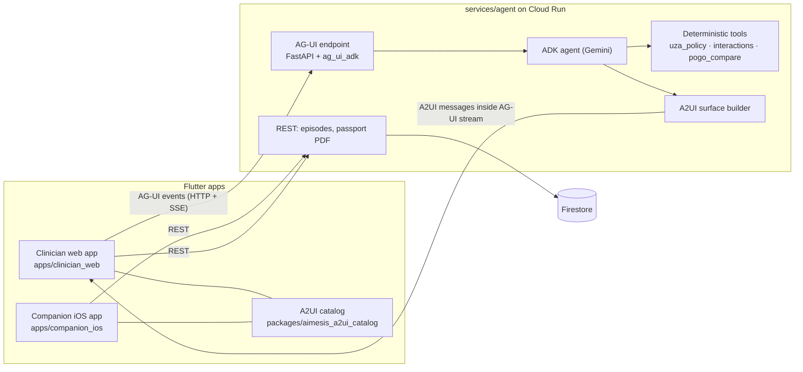

# rabo4good-AImesis

AI-assisted control of chemotherapy-induced nausea and vomiting (CINV) in children.
Built by the Rabobank team at **Solve with Google: Hacking for Good 2026** (Wintercircus Ghent, 29 Oct 2026), use case 3 for the Belgian Society of Paediatric Haematology and Oncology (BSPHO), with clinical leads from UZA (University Hospital Antwerp).

> **Prototype. Not for clinical use.** No real patient data goes into this repo, the apps, logs or prompts.

---

## What we are building

| Who uses it | App | What it does |
|---|---|---|
| Oncologist, nurse specialist, clinical pharmacist | **Clinician web app** (Flutter web) | Classifies the chemo regimen, calculates antiemetic doses, applies the dexamethasone rules, screens interactions, compares UZA v2 with POGO, and produces the CINV Patient Passport. |
| Parents and the child at home | **Companion app** (Flutter iOS) | One tap per episode of nausea or vomiting, the family's Passport schedule in NL, FR or EN, and the log feeds the next cycle. |

It covers the six UZA user stories plus the companion-app bonus:

1. Emetogenicity classification (UZA v2 tiers, dose thresholds, combination rules, per-day tiers)
2. Antiemetic doses from BSA, weight and age, with formula and source shown
3. Personalisation: dexamethasone block, route and formulation, previous-cycle history, breakthrough steps
4. CINV Patient Passport (one page, NL/FR/EN, dual sign-off)
5. UZA v2 vs POGO comparison
6. Drug interaction and contraindication screening
- Bonus: companion app for logging episodes

The full acceptance criteria, expected outputs for Casus 1–3, edge cases and the open questions for the pharmacists are in the team doc **"AImesis — Build-ready User Stories (UZA v2)"** (shared via claude.ai). A clickable reference prototype of all pages is shared there as well.

---

## Ground rules (the jury checks these)

1. **The model never calculates.** Risk tiers, doses, durations, dexamethasone blocks and interaction alerts come from deterministic Python in `services/agent/app/tools/`. The LLM only extracts structure from free text (ward notes, orders), picks which tool to call, and writes the summary and family wording.
2. **Every clinical line cites its rule.** For example "UZA v2 p.2 · Ondansetron 5 mg/m², max 8 mg/dose".
3. **Refuse rather than guess.** If BSA, weight or age is missing, or a drug is not in UZA v2, show what is missing and calculate nothing.
4. **Advisory only, two sign-offs.** Every screen shows "Advisory only — requires clinician sign-off". Export needs the oncologist and the pharmacist.
5. **Belgian grounding.** Formulations and interactions cite BCFI/CBIP. Family links come from the Belgian resources sheet.
6. **Source of truth:** UZA "Anti-emetica beleid CINV" juli 2026 versie 2. POGO (released 2010) is only used for the Story 5 comparison.
7. **Clinical source documents stay out of git.** Keep the UZA policy, POGO PDF, case examples and decks in `docs/source/` locally; that folder must be git-ignored.

---

## Architecture



How a request flows:

1. The clinician opens a patient in the web app. The app opens an **AG-UI** run against `services/agent` (one run per conversation or action).
2. The **ADK agent** extracts the regimen and history, then calls the deterministic **tools**. It never writes a dose itself.
3. The agent turns the tool results into **A2UI** surface messages (declarative JSON: which component, which data). They stream back to the app inside the AG-UI event stream.
4. The Flutter app renders those surfaces with **our own A2UI catalog**: only components we approved (tier badge, dose table, dexamethasone banner, interaction card, and so on). The agent can't send arbitrary UI or code.
5. User actions (sign-off, ticking a clinician option, confirming a quoted note) go back to the agent as AG-UI events.
6. The companion app writes episodes over plain REST to Firestore. The web app and the Passport read them.

### Why these three pieces

| Piece | Role here | Links |
|---|---|---|
| **AG-UI** | Transport and event protocol between the Flutter apps and the agent: streaming text, tool-call events, state updates, user actions. | [docs.ag-ui.com](https://docs.ag-ui.com/introduction) · Dart client [`ag_ui`](https://pub.dev/packages/ag_ui) · ADK server [`ag_ui_adk`](https://pypi.org/project/ag_ui_adk/) |
| **A2UI** | What the agent sends to draw UI: a declarative JSON description of surfaces and components, rendered natively from a client-side catalog. | [a2ui.org](https://a2ui.org/) · [quickstart](https://a2ui.org/quickstart/) · [github.com/a2ui-project/a2ui](https://github.com/a2ui-project/a2ui) |
| **GenUI for Flutter** | The Flutter renderer for A2UI surfaces. | [docs.flutter.dev/ai/genui](https://docs.flutter.dev/ai/genui/get-started.md) · [`genui`](https://pub.dev/packages/genui) · [`genui_a2ui`](https://pub.dev/packages/genui_a2ui) (marked discontinued in favour of [`genui_a2a`](https://pub.dev/packages/genui_a2a/versions/0.10.0)) |
| **ADK** | Agent framework, already used by the starter kit. | [adk.dev](https://adk.dev/) |

---

## Stack

| Layer | Choice |
|---|---|
| Frontend | Flutter (stable channel), Dart [pub workspaces](https://dart.dev/tools/pub/workspaces) for the monorepo |
| Clinician app | Flutter **web** |
| Companion app | Flutter **iOS** (Flutter web at phone width as the demo fallback) |
| Generative UI | A2UI rendered with GenUI, custom catalog in `packages/aimesis_a2ui_catalog` |
| Agent transport | AG-UI over HTTP + SSE |
| Agent | Google ADK (Python), Gemini, FastAPI, `ag_ui_adk`, managed with `uv` |
| Data | Firestore (native mode) for episodes and Passport history |
| Infra | Terraform, Cloud Run (`agent`, `clinician-web`), Artifact Registry, region `europe-west1` |
| CI | GitHub Actions (`.github/workflows/ci.yml`) |

---

## Repository layout

Every file below exists and is **empty**. Fill them in as you build.

```
.
├── README.md                     ← this file
├── pubspec.yaml                  Dart pub workspace root (lists apps/* and packages/*)
├── analysis_options.yaml         shared Dart lints
├── Makefile                      one-liners: run web, run iOS, run agent, test all
├── .github/
│   ├── workflows/ci.yml          flutter analyze + test, pytest, terraform fmt/validate
│   └── pull_request_template.md
│
├── apps/
│   ├── clinician_web/            Flutter web app for the care team
│   │   ├── lib/main.dart, app.dart, router.dart
│   │   ├── lib/agent/            AG-UI session + host widget for A2UI surfaces
│   │   ├── lib/features/         one folder per story page:
│   │   │     patient/            patient + regimen panel (shared by all pages)
│   │   │     risk_tier/          Story 1
│   │   │     doses/              Story 2
│   │   │     personalise/        Story 3
│   │   │     passport/           Story 4
│   │   │     uza_vs_pogo/        Story 5
│   │   │     interactions/       Story 6
│   │   │     signoff/            oncologist + pharmacist sign-off
│   │   ├── web/                  index.html, manifest.json
│   │   └── test/
│   └── companion_ios/            Flutter iOS app for families
│       ├── lib/features/         pairing (patient code), log (two big buttons), history, passport
│       ├── lib/services/         episode API client, offline queue
│       ├── lib/l10n/             app_nl.arb, app_fr.arb, app_en.arb
│       ├── ios/                  generated by `flutter create` (see setup)
│       └── test/
│
├── packages/
│   ├── aimesis_core/             pure Dart: models (patient, chemo row, plan, DDI alert,
│   │                             episode, passport), AG-UI client wrapper, episodes API
│   ├── aimesis_a2ui_catalog/     Flutter: the ONLY components the agent may render
│   │   ├── catalog.json          catalog definition shared with the agent
│   │   └── lib/src/components/   tier_badge, day_tier_strip, dose_table, schedule_grid,
│   │                             dex_status_banner, ddi_alert_card, uza_pogo_table,
│   │                             notes_quote, clinician_option, advisory_banner
│   └── golden/                   cases.json, edge_cases.json, expected.json
│                                 ← the single source of expected results; Python and
│                                   Dart tests both read these
│
├── services/
│   └── agent/                    Python: ADK agent + AG-UI endpoint + REST
│       ├── app/main.py           FastAPI app: mounts AG-UI endpoint + REST routes, CORS
│       ├── app/agui_endpoint.py  ag_ui_adk wiring
│       ├── app/agent.py          ADK agent: instructions, tool list, guardrails
│       ├── app/a2ui/             catalog.py (mirrors catalog.json), surfaces.py (tool result → A2UI)
│       ├── app/tools/            uza_policy.py      Stories 1–3 (deterministic)
│       │                         interactions.py    Story 6
│       │                         pogo_compare.py    Story 5
│       │                         notes_extraction.py  Gemini: ward note → quoted history
│       ├── app/passport/         render.py (PDF), translations.py (NL/FR/EN family text)
│       ├── app/episodes/         store.py (Firestore), routes.py (REST)
│       ├── app/schemas.py        Pydantic models; must match packages/aimesis_core
│       └── tests/                unit (golden, rules, A2UI), integration (AG-UI), eval
│
├── infra/terraform/              APIs, Artifact Registry, Cloud Run x2, Firestore, IAM
│   └── env/dev.tfvars            project id, region; no secrets
│
└── docs/
    ├── architecture.md           decisions behind the diagram above
    ├── api-contract.md           AG-UI events we use, REST endpoints, payload shapes
    ├── a2ui-catalog.md           each component: purpose, props, which story uses it
    ├── clinical-rules.md         UZA v2 rules as implemented, with page references
    ├── open-questions.md         questions for the UZA pharmacists + their answers
    └── decisions.md              short log: date, decision, why
```

---

## Who owns what

| Person | Area | Main folders |
|---|---|---|
| Person 1 | Clinician web app + companion iOS app | `apps/*`, `packages/aimesis_a2ui_catalog` |
| Person 2 | Rules engine (Stories 1–3) | `services/agent/app/tools/uza_policy.py`, `packages/golden` |
| Person 3 | Agent, AG-UI endpoint, A2UI surfaces, deployment | `services/agent/app/{main,agent,agui_endpoint}.py`, `app/a2ui/`, `infra/` |
| Person 4 | Clinical link to UZA + Passport output | `docs/open-questions.md`, `app/passport/`, `tests/eval/` |
| Person 5 | Interactions (Story 6) + UZA vs POGO (Story 5) | `app/tools/interactions.py`, `app/tools/pogo_compare.py` |

Shared, agree before 12:00: `packages/aimesis_core` models ↔ `services/agent/app/schemas.py`, `catalog.json`, and `docs/api-contract.md`. Change them only with a heads-up in the team chat.

---

## Getting started

### Prerequisites

- Flutter SDK (stable) with Dart 3.6 or later (needed for pub workspaces)
- Python 3.12 and [`uv`](https://docs.astral.sh/uv/)
- `gcloud` logged in to the lab project, Terraform
- **For iOS: a Mac with Xcode.** The lab VMs are Linux and can't build iOS. Without a Mac, run the companion app as Flutter web at phone width.

### First-time setup (after the files have content)

```bash
# Flutter platform folders are generated, not hand-written:
cd apps/clinician_web && flutter create --platforms=web --project-name clinician_web .
cd ../companion_ios   && flutter create --platforms=ios --project-name companion_ios .
cd ../.. && flutter pub get            # resolves the whole workspace

# Agent
cd services/agent && uv sync && cp .env.example .env
```

### Run locally

```bash
cd services/agent && uv run uvicorn app.main:app --reload --port 8000   # agent + AG-UI + REST
cd apps/clinician_web && flutter run -d chrome --dart-define=AGENT_URL=http://localhost:8000
cd apps/companion_ios && flutter run -d ios   # or: flutter run -d chrome
```

### Test

```bash
flutter test                                  # from each app/package
cd services/agent && uv run pytest tests/unit
```

### Deploy

```bash
cd infra/terraform && terraform init && terraform apply -var-file=env/dev.tfvars
```

---

## Known risks — check these first

1. **A2UI version match.** `ag_ui_adk` emits A2UI v0.9 by default; check which version the Flutter GenUI packages render and pin both sides to the same one.
2. **A2UI over AG-UI in Flutter.** `genui_a2ui` connects over A2A. Carrying A2UI inside an AG-UI stream from Flutter may need a small adapter in `apps/clinician_web/lib/agent/` that takes A2UI messages from AG-UI events and passes them to GenUI. Spike this in the first hour.
3. **Gemini location.** Use `GOOGLE_CLOUD_LOCATION=global`; the starter's guide says to change the location, not the model, on model 404s.
4. **CORS** between the Flutter web origin and Cloud Run: allow it in `app/main.py` from the start.
5. **iOS signing.** Running on a real iPhone needs a Mac and an Apple ID in Xcode. Decide by 13:00 whether the demo uses an iPhone or Flutter web.

---

## Today

| Time | Milestone |
|---|---|
| 12:00 | Shared contracts agreed (`aimesis_core` ↔ `schemas.py`, `catalog.json`, `api-contract.md`). AG-UI + A2UI spike shows one surface in Flutter. |
| 12:30 | `uza_policy.py` passes the golden cases. Pharmacists have answered at least half the open questions. |
| 14:30 | Web app runs all six story pages against the live agent. Companion app logs episodes to Firestore. |
| 15:30 | Deployed on Cloud Run. Feature freeze: fixes only. |
| 16:00 | Two demo run-throughs on the live build (Casus 1 → 2 → 3). |
| 16:30 | Showcase |

## Working agreements

- Branch per person (`p1/web-passport`, `p2/uza-policy`, …), small PRs into `main`. One reviewer is enough today.
- `main` must always build and run.
- No secrets or real patient data in git. Put config in `.env` (local only) and `.env.example` (names only).
- Golden cases change only through `packages/golden` and both test suites.
