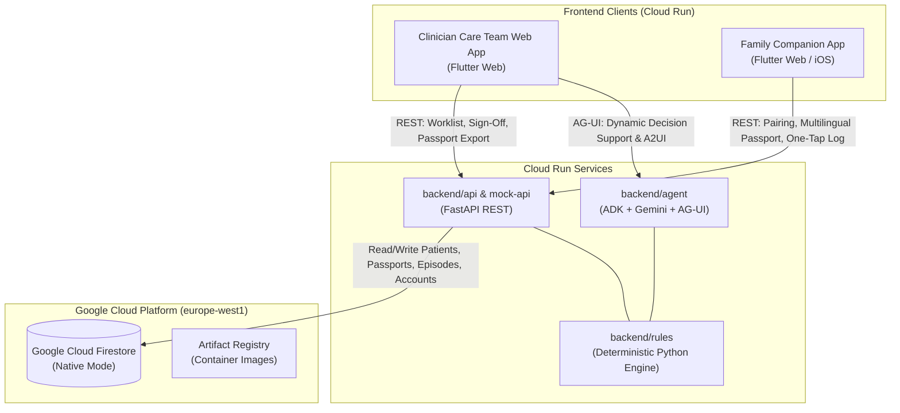

# AImesis System Architecture

This document provides the high-level system architecture and component topology for **rabo4good-AImesis** (Solve with Google: BSPHO 2026 Use Case 3 · Pediatric CINV Control).

---

## 1. High-Level Topology

---

## 2. Key Architectural Layers

1. **Deterministic Rules Engine (`backend/rules`)**:
   - Pure Python with zero LLM and zero framework dependencies.
   - Enforces UZA July 2026 v2 policy emetic risk tiering, dose formulas (BSA/weight), Olanzapine 0.5 mg floor rounding, and hard contraindication blocks ("GEEN Dexamethasone" in ALL and brain tumors).
   - Literature cross-checks UZA v2 against POGO 250111 guidelines.

2. **AI Decision Support Agent (`backend/agent`)**:
   - Google Agent Development Kit (ADK) + Gemini.
   - Interprets unstructured ward progress notes (`toernota`) and emits structured A2UI components over AG-UI.

3. **Clinical REST API (`backend/api` & `backend/mock_api`)**:
   - FastAPI service managing patient context, passport lifecycles, dual clinician sign-offs (oncologist + pharmacist), and family episode logging.

4. **Google Cloud Firestore Database**:
   - Native mode, multi-collection datastore providing real-time synchronization between hospital clinicians and families at home.
   - See [Firestore Database Overview](file:///config/.gemini/antigravity/scratch/rabo4good-AImesis/docs/firestore-database-overview.md) for full collection schemas and live data.
   - See [Firestore Integration Guide](file:///config/.gemini/antigravity/scratch/rabo4good-AImesis/docs/firestore-integration.md) for Terraform deployment and client connection patterns.

5. **Frontends (`frontend/web` & `frontend/ios`)**:
   - **Clinician Web App**: Care-team cockpit for oncologists, pharmacists, and nurses.
   - **Family Companion App**: Mobile app for patients and parents featuring 7-character pairing (e.g. `PAIR-ABC`), localized day-by-day schedules (NL/FR/EN), and one-tap nausea/vomiting logging with offline replay.
