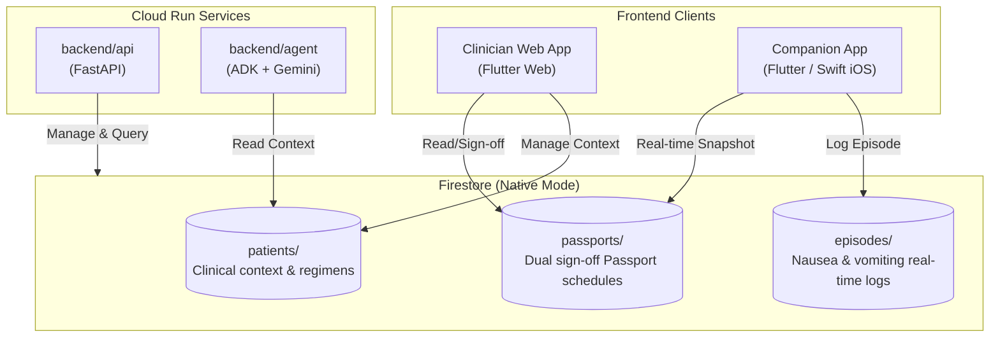

# Firestore Database Integration Guide

This guide details the Google Cloud Firestore (Native mode) setup for **rabo4good-AImesis**, including Terraform deployment, data models, and client connection patterns for Flutter Web, iOS, and Python.

---

## 1. Architecture & Collections

Firestore provides real-time cross-platform synchronization between the Clinician Web App, the Family Companion App, and the Cloud Run backend services.



### Collections Overview

| Collection | Document ID | Purpose | Schemas / Contract |
|---|---|---|---|
| `patients` | `patient_id` (e.g. `PAT-2026-0042`) | Pseudonymized patient metrics (age, weight, BSA, planned chemotherapy regimen). | [`patient_context.schema.json`](file:///config/.gemini/antigravity/scratch/rabo4good-AImesis/contracts/schemas/patient_context.schema.json) |
| `passports` | `passport_id` (e.g. `PSP-2026-0042-C1`) | CINV Patient Passport: UZA v2 emetic tier, antiemetic schedule, dexamethasone rules, breakthrough steps, oncologist & pharmacist sign-offs, family schedules in NL/FR/EN. | [`passport.schema.json`](file:///config/.gemini/antigravity/scratch/rabo4good-AImesis/contracts/schemas/passport.schema.json) |
| `episodes` | `episode_id` (UUID) | Real-time nausea/vomiting episodes logged by the family companion app. | [`episode.schema.json`](file:///config/.gemini/antigravity/scratch/rabo4good-AImesis/contracts/schemas/episode.schema.json) |

---

## 2. Deploying via Terraform

The Terraform configuration resides in [`infra/terraform/`](file:///config/.gemini/antigravity/scratch/rabo4good-AImesis/infra/terraform).

### Pre-configured Lab Settings
- **Project ID**: `qwiklabs-gcp-00-cc29ec8bfdd9`
- **Database Type**: `FIRESTORE_NATIVE`
- **Region**: `europe-west1`
- **Zone**: `europe-west1-b`
- **Firestore Location**: `europe-west1`
- **Lab Deletion Policies**:
  - `delete_protection_state = "DELETE_PROTECTION_DISABLED"`
  - `deletion_policy = "DELETE"`

### Deployment Commands

```bash
cd infra/terraform

# Initialize Terraform providers
terraform init

# Review execution plan with dev variables
terraform plan -var-file="env/dev.tfvars"

# Apply changes to provision Firestore
terraform apply -var-file="env/dev.tfvars" -auto-approve
```

---

## 3. Connecting from Web (Flutter / Dart)

### Package Dependency
In `frontend/web/pubspec.yaml` (or `frontend/shared/`):
```yaml
dependencies:
  firebase_core: ^3.6.0
  cloud_firestore: ^5.4.4
```

### Initialization & Real-Time Passport Stream
```dart
import 'package:firebase_core/firebase_core.dart';
import 'package:cloud_firestore/cloud_firestore.dart';

void initFirestore() async {
  await Firebase.initializeApp(
    options: const FirebaseOptions(
      projectId: 'qwiklabs-gcp-00-cc29ec8bfdd9',
      apiKey: 'YOUR_API_KEY',
      appId: 'YOUR_APP_ID',
      messagingSenderId: 'YOUR_SENDER_ID',
    ),
  );
}

// Listen to patient's active passport
Stream<DocumentSnapshot> listenToActivePassport(String passportId) {
  return FirebaseFirestore.instance
      .collection('passports')
      .doc(passportId)
      .snapshots();
}
```

---

## 4. Connecting from iOS (Flutter or Native Swift)

### Option A: Flutter iOS (Recommended)
Same as Web: use `cloud_firestore` in `frontend/ios`.

### Option B: Native Swift (SwiftUI)
Add the `FirebaseFirestore` package via Swift Package Manager (`https://github.com/firebase/firebase-ios-sdk`):

```swift
import FirebaseCore
import FirebaseFirestore

class EpisodeTracker: ObservableObject {
    private var db = Firestore.firestore()
    
    // Log nausea/vomiting episode
    func logEpisode(patientId: String, passportId: String, symptom: String, severity: String) {
        let episodeData: [String: Any] = [
            "episode_id": UUID().uuidString,
            "patient_id": patientId,
            "passport_id": passportId,
            "timestamp": ISO8601DateFormatter().string(from: Date()),
            "symptom_type": symptom,
            "severity": severity,
            "reported_by": "parent",
            "created_at": ISO8601DateFormatter().string(from: Date())
        ]
        
        db.collection("episodes").addDocument(data: episodeData) { error in
            if let error = error {
                print("Error logging episode: \(error.localizedDescription)")
            } else {
                print("Episode successfully logged to Firestore!")
            }
        }
    }
}
```

---

## 5. Connecting from Python Backend (`backend/api`)

The Python store modules are implemented in [`aimesis_api.episodes.store`](file:///config/.gemini/antigravity/scratch/rabo4good-AImesis/backend/api/src/aimesis_api/episodes/store.py):

```python
from aimesis_api.episodes.store import PassportStore, EpisodeStore, PatientStore

passport_store = PassportStore()
episode_store = EpisodeStore()

# 1. Fetch active passport
passport = passport_store.get_active_passport_for_patient("PAT-2026-0042")

# 2. Record dual sign-off
passport_store.sign_off_passport(
    passport_id="PSP-2026-0042-C1",
    role="clinical_pharmacist",
    clinician_name="Dr. S. Janssens",
    riziv_inami="1-12345-67-890",
)

# 3. Retrieve recent episodes for analysis
episodes = episode_store.list_episodes_for_patient("PAT-2026-0042")
```
