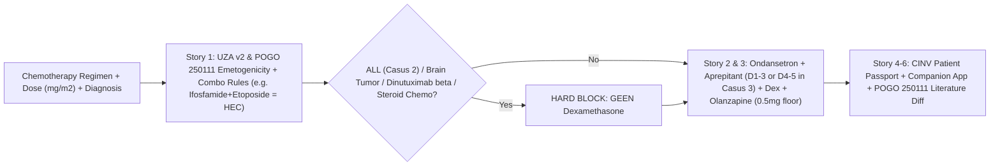

# UC3 Quickstart: AImesis Pediatric CINV Clinical Decision Support & Patient Passport (UZA Policy v2)

## 1. Introduction & Clinical Challenge

Duration: 02:00

Welcome to **Use Case 3 (AImesis: Pediatric CINV Control)** at **Solve with Google: BSPHO 2026 (Wintercircus Ghent)**.

Chemotherapy-Induced Nausea and Vomiting (**CINV**) is one of the most distressing treatment toxicities for children with cancer. At **UZA (University Hospital Antwerp — Koningin Mathilde Moeder- en kindcentrum)**, Hospital Pharmacists **Katleen Balliauw & Anthe De Pauw** have grounded pediatric antiemetic prophylaxis in **`Anti-emetica beleid CINV - V2.pdf` (July 2026 v2)**, the **87-page POGO Emetogenicity Classification Guideline (`POGO Emetogenicity Classification Guideline Final-rev- 250111.pdf`)**, **3 real-world clinical case examples (`casus voorbeelden.docx`)**, and **6 official clinical user stories (`user stories AImesis version 2.pdf`)**:

- **Story 1 (Risk Classification & Combination Escalation)**: Classify acute emetogenicity (`Minimal`, `Low`, `Moderate`, `High`) using UZA's **dose-dependent thresholds** (`Cyclophosphamide >1500 mg/m²` = High; `Cytarabine >=3 g/m²` = High; `MTX >=12 g/m²` = High; `Carboplatin` and `Doxorubicin` = UZA High) and **combination elevation rules** (including **`Ifosfamide [MEC] + Etoposide [LEC] -> High [HEC]`** per UZA v2 & POGO 250111, as demonstrated in **Casus 3**).
- **Story 2 (Prophylaxis & Hard Contraindications)**: Recommend exact weight/BSA-adjusted doses (`Ondansetron 5 mg/m² max 8 mg`, `Aprepitant`, `Dexamethasone` split at `BSA 0.6 m²` with the **IV `Aacidexam® 5 mg/mL = ±4 mg/mL` active base alert**, and **`Olanzapine 0.1 mg/kg` rounded DOWN to the nearest `0.5 mg`**) while enforcing **"GEEN Dexamethasone"** in **ALL** (**Casus 2**), **Brain Tumors (`hersentumoren`)**, **Dinutuximab beta**, and steroid-containing chemo regimens.
- **Story 3 (Patient Risk Personalization, EHR Nausea History & Breakthrough CINV)**: Screen prior cycles (e.g., ward progress notes / `toernota` in **Casus 1** & **Casus 3**), adjust formulations (liquid/syrup vs tablet vs NG tube vs IV), and step up prophylaxis (`Ondansetron 2x/d -> 3x/d` or `Palonosetron` switch in **Casus 1**; extending `Aprepitant` onto Days 4–5 for 5-day multi-day `IE` chemo in **Casus 3**).
- **Story 4 (Multilingual CINV Patient Passport & Bonus Companion App)**: Generate an actionable family schedule (`NL`/`FR`/`EN`) with curated Belgian hospital contact links (`CINV resources in Belgium.xlsx`) plus a **bonus Companion App tracker** where parents/patients can log each instance of nausea with a single button tap.
- **Story 5 & 6 (UZA v2 vs. POGO 250111 Literature Cross-Check & CYP3A4/QTc DDI Screening)**: Compare UZA's July 2026 v2 policy with the POGO 250111 guideline side-by-side and flag lethal CYP3A4/QTc interactions.

### Official UZA Clinical Case Examples (`casus voorbeelden.docx`)

| Case | Patient & Protocol | Regimen & Emetogenicity | Prior Cycle History (`toernota` / EPD) | Expected AImesis Recommendation |
| :--- | :--- | :--- | :--- | :--- |
| **Casus 1** | **16yo girl**, Neuroblastoma (`HR-NBL2`, **RAPID COJEC** Induction: alternating `A1/B1/C1/B2/A2/B3/C2/B4`) | Upcoming **Cyclus B4 (25/09/2026)**: `Vincristine` (Low) + `Cisplatin` (High) $\rightarrow$ **HEC** | On Cycle B3 (05/09), prescribed Ondansetron **2x/d** + Aprepitant + Dexamethasone + Olanzapine; **still had nausea on Day 2** in `toernota`. | Step up Ondansetron from 2x/d to full HEC **3x/d** (or switch to IV **Palonosetron** — never combine with Ondansetron within 3 days) + Aprepitant + Dexamethasone (50% CYP3A4 reduced) + evening Olanzapine; add breakthrough Alizapride/Lorazepam & log in Companion App. |
| **Casus 2** | **2yo boy**, Acute Lymphoblastic Leukemia (`ALLTogether1`, **Induction B**, Day 8) | **Day 8 Chemo**: `Vincristine` (Low) + `Daunorubicin` (MEC) $\rightarrow$ **MEC** | No nausea or vomiting reported in prior administration. | **Ondansetron (2x/d) + Aprepitant**. **STRICT BLOCK: `GEEN Dexamethasone bij ALL`!** |
| **Casus 3** | Pediatric/adolescent **Ewing Sarcoma** (`iEuroEwing`, alternating `VDC` & `IE`, starting **5-day `IE` Cycle #3**) | **5-day `IE` course**: `Ifosfamide` (MEC alone) + `Etoposide` (LEC alone) $\rightarrow$ **Combination = HEC** (per UZA v2 & POGO 250111) | Breakthrough nausea & vomiting documented on **Day 4** of previous 5-day `IE` cycles. | Maximal HEC quadruple prophylaxis (**Ondansetron 3x/d + Dexamethasone + Aprepitant + Olanzapine**) + consider **extending Aprepitant onto Days 4 and 5** for the 5-day multi-day regimen. |



> aside positive
> **Clinical Leads & CE POC**: Katleen Balliauw & Anthe De Pauw (Hospital Pharmacists, UZA) & Payam Ebrahimi (`@payame`, Google Cloud).

## 2. Environment & UZA Policy v2 + POGO 250111 Dataset Setup

Duration: 03:00

Verify that all 7 official UC3 files (`Anti-emetica beleid CINV - V2.pdf`, `POGO Emetogenicity Classification Guideline Final-rev- 250111.pdf`, `casus voorbeelden.docx`, `user stories AImesis version 2.pdf`, `AImesis_pediatric CINVcontrol clinical decision support .pptx`, `Pitch slides AImesis versie 2 .pptx`, and `CINV resources in Belgium.xlsx`) are synced into your workspace:

```bash
export PROJECT_ID=$(gcloud config get-value project)
mkdir -p /config/Desktop/use-cases

gcloud storage cp -r "gs://use-cases-${PROJECT_ID}/3. AImesis CINV Control" /config/Desktop/use-cases/ 2>/dev/null || \
  gcloud storage cp -r "gs://swg-workshop/use-case/3. AImesis CINV Control" /config/Desktop/use-cases/

ls -lh "/config/Desktop/use-cases/3. AImesis CINV Control/"
```

You should see output similar to:

```console
AImesis_pediatric CINVcontrol clinical decision support .pptx
Anti-emetica beleid CINV - V2.pdf
CINV resources in Belgium.xlsx
POGO Emetogenicity Classification Guideline Final-rev- 250111.pdf
Pitch slides AImesis versie 2 .pptx
casus voorbeelden.docx
user stories AImesis version 2.pdf
```

## 3. Stories 1–3: UZA v2 Dose-Dependent Emetogenicity, Olanzapine Floor Rounding & "GEEN Dexamethasone"

Duration: 06:00

Let's test `evaluate_uza_cinv_policy_v2` across a High-Risk regimen (`Cisplatin` + `Doxorubicin`) and verify:
1. `Olanzapine` (`0.1 mg/kg` on an `18.9 kg` child = `1.89 mg` raw) is **rounded DOWN to the nearest `0.5 mg` (`1.5 mg`)**.
2. The IV `Aacidexam® 5 mg/mL = ±4 mg/mL` active dexamethasone base conversion warning is included.
3. Passing `diagnosis="ALL"` or `diagnosis="Brain tumor (medulloblastoma)"` triggers **`GEEN_DEXAMETHASONE_CONTRAINDICATION`**.

```bash
cat << 'EOF' > test_uc3_uza_policy.py
from agents.uc3_aimesis.agent import (
    evaluate_uza_cinv_policy_v2,
    generate_cinv_patient_passport,
)

# 1. High-risk solid tumor (Osteosarcoma: Cisplatin + Doxorubicin, 18.9 kg, BSA 0.76 m2)
res_solid = evaluate_uza_cinv_policy_v2(
    drug_list=["cisplatin", "doxorubicin"],
    patient_age_years=6.0,
    patient_weight_kg=18.9,
    bsa_m2=0.76,
    drug_doses_mg_m2={"cisplatin": 60.0, "doxorubicin": 37.5},
    indication="osteosarcoma",
    can_swallow_tablets=False,
    anticipatory_vomiting=True,
)
print("Solid Tumor Tier:", res_solid["overall_tier"])
print("Olanzapine Schedule (18.9 kg * 0.1 mg/kg = 1.89 -> floor 1.5 mg):", res_solid["dosing_schedule"]["olanzapine"])
print("Dexamethasone Schedule & Aacidexam Alert:", res_solid["dosing_schedule"]["dexamethasone"])

# 2. Brain tumor / ALL — verify mandatory "GEEN Dexamethasone" block
res_brain = evaluate_uza_cinv_policy_v2(
    drug_list=["cyclophosphamide"],
    patient_age_years=9.0,
    patient_weight_kg=28.0,
    bsa_m2=1.02,
    drug_doses_mg_m2={"cyclophosphamide": 1800.0},
    indication="brain_tumor",
    can_swallow_tablets=False,
    anticipatory_vomiting=True,
)
print("\nBrain Tumor Tier (Cyclophosphamide 1800 mg/m2):", res_brain["overall_tier"])
print("Dexamethasone Contraindicated?:", res_brain["dexamethasone_contraindicated"])
print("Dexamethasone Rule:", res_brain["dosing_schedule"]["dexamethasone"])
EOF
python3 test_uc3_uza_policy.py
rm -f test_uc3_uza_policy.py
```

You should see output similar to:

```console
Solid Tumor Tier: High
Olanzapine Schedule (18.9 kg * 0.1 mg/kg = 1.89 -> floor 1.5 mg): 1.5 mg PO 1x/day (0.1 mg/kg = 1.89 mg rounded DOWN to nearest 0.5 mg)
Dexamethasone Schedule & Aacidexam Alert: ... (IV Aacidexam 5 mg/mL = 4 mg/mL base alert)

Brain Tumor Tier (Cyclophosphamide 1800 mg/m2): High
Dexamethasone Contraindicated?: True
Dexamethasone Rule: CONTRAINDICATED (GEEN Dexamethasone — UZA Policy v2)
```

> aside negative
> **Critical Clinical Safety Rule**: Never recommend Dexamethasone for CINV in children with **ALL** (interferes with leukemia steroid backbone), **Brain Tumors** (alters blood-brain barrier permeability and chemotherapy penetration), or **Dinutuximab beta** immunotherapy (blunts ADCC immune response).

## 4. Story 4 & Story 5: Multilingual CINV Patient Passport & Literature Cross-Check

Duration: 06:00

Parents discharged home after chemotherapy need a clear, jargon-free daily schedule (**Story 4: CINV Patient Passport**) with red-flag dehydration signs and direct links to verified Belgian hospital brochures (avoiding the *"Brussels Bilingual Redirection Loop"* documented in `CINV resources in Belgium.xlsx`).

### Generate the CINV Patient Passport & Run the ADK Agent

```bash
cat << 'EOF' > test_uc3_passport.py
from agents.uc3_aimesis.agent import (
    evaluate_uza_cinv_policy_v2,
    generate_cinv_patient_passport,
)

uza_eval = evaluate_uza_cinv_policy_v2(
    drug_list=["cyclophosphamide"],
    patient_age_years=9.0,
    patient_weight_kg=28.0,
    bsa_m2=1.02,
    drug_doses_mg_m2={"cyclophosphamide": 1800.0},
    indication="brain_tumor",
)
passport = generate_cinv_patient_passport(
    patient_alias="Lucas (9y)",
    uza_evaluation=uza_eval,
    ddi_alerts=[],
    qtc_assessment={"risk_tier": "LOW", "cumulative_score": 0},
)
print("Passport Patient:", passport["patient_alias"], "| Tier:", passport["emetogenicity_tier"])
print("Dexamethasone Blocked:", passport["dexamethasone_blocked"])
print("Belgian Family Resources Count:", len(passport["belgian_family_resources"]))
EOF
python3 test_uc3_passport.py
rm -f test_uc3_passport.py

# Run full UC3 ADK agent (including Story 5 UZA v2 vs POGO comparison)
./bin/swg-ctl agents run \
  --agent uc3_aimesis \
  --query "7yo patient at UZA (22 kg, BSA 0.85 m2) with ALL receiving Cyclophosphamide 1600 mg/m2 and Vincristine alongside Voriconazole antifungal prophylaxis. Provide UZA v2 CINV prophylaxis, check CYP3A4/QTc interactions, compare UZA v2 vs POGO, and generate a Dutch Patient Passport."
```

You should see output similar to:

```console
Passport Patient: Lucas (9y) | Tier: High
Dexamethasone Blocked: True
Belgian Family Resources Count: 5
```

## 5. Negative Safety Testing: Voriconazole + Vincristine CYP3A4 Block & Cumulative QTc

Duration: 04:00

Verify that `screen_cyp3a4_and_qtc_interactions` flags the **severe CYP3A4 inhibition** between `Voriconazole` (or `Posaconazole`) and `Vincristine` (risk of severe peripheral neuropathy and paralytic ileus) as well as cumulative QTc prolongation when combining `Ondansetron` + `Domperidone` / `Haloperidol`.

```bash
pytest use_cases/03_aimesis/tests/ tests/test_swg_platform.py -k "uc3 or aimesis" -v
```

You should see output similar to:

```console
============================== passed in 0.44s ==============================
```

## 6. Verification & Jury Showcase Checklist

Duration: 02:00

### 3-Minute Wintercircus Jury Demo Tips
- **Show Dose-Dependent Escalation (Story 1)**: Show `Cyclophosphamide 1000 mg/m²` (`Moderate`) stepping up to `High` at `1600 mg/m²`, or `2x Moderate` agents combining to `High`.
- **Trigger "GEEN Dexamethasone" & `Olanzapine 0.5 mg` Floor Rounding (Story 2)**: Demonstrate the hard block on Dexamethasone in ALL / Brain Tumors / Dinutuximab beta and show `18.9 kg * 0.1 mg/kg = 1.89 mg -> 1.5 mg` floor rounding.
- **Display the Story 4 Patient Passport & Story 5 Literature Diff**: Show the family-ready Dutch/French passport side-by-side with the clinician's UZA v2 vs. POGO comparison table.
